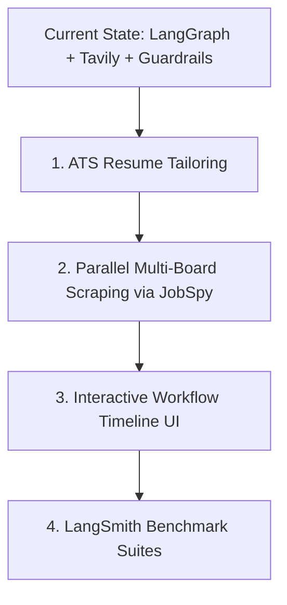

# JobFlow AI - Advanced Future Work Roadmap

This document outlines the technical design, benefits, and step-by-step implementation roadmaps for the premium enhancements proposed to elevate **JobFlow AI** into a state-of-the-art career automation suite.

---

## 🚀 Roadmap Overview



---

## 1. ATS-Targeted Resume Customization Pipeline
### 💡 The Concept
Uploading a static resume PDF for every job listing limits your recruiter callbacks because modern Application Tracking Systems (ATS) score candidates based on keyword density matching the job description. The ATS Customizer will semantically adjust your resume bullet points and professional summary to fit each job description *before* uploading it.

### 🛠️ Implementation Path
1. **Keyword Analyzer:** Implement a text extraction function inside [llm.py](file:///c:/Users/woonn/OneDrive/Desktop/3%20Am%20things/job%20applying/llm.py) that parses the job description and extracts the top 10 required skills and libraries (e.g. `FAISS`, `RAG`, `Agentic AI`).
2. **Dynamic Resume Recompiler:** Use the Google Gemini model to adjust your professional summary and selected bullet points inside [resume.txt](file:///c:/Users/woonn/OneDrive/Desktop/3%20Am%20things/job%20applying/resume.txt) so that they directly highlight experiences that match those exact target keywords.
3. **Resilient Compile & Upload:**
   * Output a clean, tailored text file `resume_tailored.txt` (or use a lightweight Python library like `FPDF` to recompile a beautiful PDF file `resume_tailored.pdf`).
   * Instruct Playwright inside [agent.py](file:///c:/Users/woonn/OneDrive/Desktop/3%20Am%20things/job%20applying/agent.py) to upload `resume_tailored` instead of your static resume.

---

## 2. Multi-Board Parallel Scraping via JobSpy
### 💡 The Concept
Playwright is highly stealthy, but manually crawling search results inside a headful browser is slow and limits search results to a single platform. Integrating an background API-driven scraping pipeline enables parallel job aggregation.

### 🛠️ Implementation Path
1. **Install python-jobspy:** Add `tavily-python`, `python-jobspy`, and `langchain-community` dependencies.
2. **Define LangGraph Aggregator Node:** Replace `search_node` or augment it with a background JobSpy scraper:
   ```python
   from jobspy import scrape_jobs
   
   def crawl_jobs_via_jobspy(keywords: List[str], locations: List[str]) -> List[dict]:
       jobs_df = scrape_jobs(
           site_name=["linkedin", "indeed", "ziprecruiter", "glassdoor"],
           search_term=keywords[0],
           location=locations[0],
           results_wanted=25,
           country_value="india",
           easy_apply=True
       )
       # Convert pandas DataFrame to structured dictionary records
       return jobs_df.to_dict(orient="records")
   ```
3. **Queue-driven Graph state:** Feed the crawled records directly into the state graph, allowing the browser to navigate immediately to direct Easy Apply pages, bypassing initial list scrolling completely.

---

## 3. Interactive Workflow Timeline & Observability UI
### 💡 The Concept
Providing real-time feedback on what the agent is doing makes the system feel premium and interactive. By streaming LangGraph state transitions over the active WebSocket, we can display an active, animated flowchart on the dashboard.

### 🛠️ Implementation Path
1. **Structured WebSocket Events:** Inside [main.py](file:///c:/Users/woonn/OneDrive/Desktop/3%20Am%20things/job%20applying/main.py) and [agent.py](file:///c:/Users/woonn/OneDrive/Desktop/3%20Am%20things/job%20applying/agent.py), broadcast structured JSON payloads containing:
   * `active_node`: (e.g. `"Search"`, `"Stealth Form Fill"`, `"Review"`, `"Applied"`)
   * `current_field`: The name of the field currently being populated.
   * `token_cost`: Calculated prompt and output tokens used for Gemini.
2. **Dashboard Visualizer:** Build an animated pipeline stepper in the front-end dashboard (using vanilla CSS transitions) that glows and transitions between nodes in real-time as the agent proceeds.

---

## 4. LangSmith Tracing & Quality Benchmarking
### 💡 The Concept
When scraping forms, prompts are updated frequently. Integrating automated regression tests ensures prompt changes don't break existing Q&A fields.

### 🛠️ Implementation Path
1. **Tracing Setup:** Activate your LangSmith credentials inside [.env](file:///c:/Users/woonn/OneDrive/Desktop/3%20Am%20things/job%20applying/.env).
2. **Create Q&A Dataset:** Create a standard dataset of 50 common screening questions inside your LangSmith dashboard.
3. **Automated Evaluators:** Run regular evaluators using `langsmith` libraries to assert that the generated answer matches target datatypes (boolean, integer) without opening a browser window.
